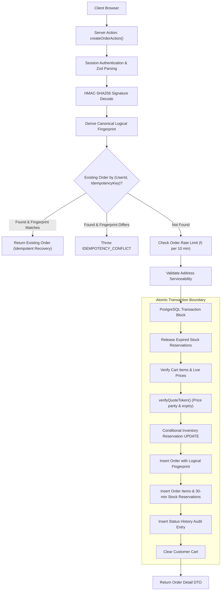

# HS Spare Parts — Automotive E-Commerce Platform

> High-integrity automotive spare parts marketplace built for the Indian aftermarket, featuring vehicle fitment guarantees, atomic inventory reservations, cryptographic checkout quotes, and idempotent order lifecycle management.

---

## Overview

**HS Spare Parts** is a modern automotive e-commerce platform designed to address the challenges of parts identification, catalogue accuracy, and inventory integrity in the multi-brand automotive spares industry.

The platform guarantees part-to-vehicle compatibility through a vehicle fitment validation engine, enforces atomic stock reservations to eliminate overselling during high-demand checkouts, and utilizes HMAC-SHA256 signed checkout quotes to guarantee price integrity between cart review and final payment settlement.

---

## Tech Stack

| Layer | Technologies |
| :--- | :--- |
| **Framework** | [Next.js 15](https://nextjs.org/) (App Router, React 19, Server Actions) |
| **Language** | [TypeScript 5.9](https://www.typescriptlang.org/) (Strict Mode) |
| **Styling** | [Tailwind CSS 3.4](https://tailwindcss.com/) with Custom Brand System |
| **Database & ORM** | [PostgreSQL](https://www.postgresql.org/) via [Drizzle ORM 0.39](https://orm.drizzle.team/) & Neon Serverless Driver |
| **Data Validation** | [Zod 3.24](https://zod.dev/) (Runtime input validation & schema enforcement) |
| **Security & Cryptography** | Native `crypto` (HMAC-SHA256), `bcryptjs`, constant-time comparisons |
| **Testing** | [Vitest 5.1](https://vitest.dev/) (Unit, integration, and security invariants) |

---

## Core Features (Phases 1–6)

### 1. Storefront & Vehicle Fitment Engine
- **Vehicle Selector Hierarchy:** Filter parts precisely by Vehicle Make $\rightarrow$ Model $\rightarrow$ Year $\rightarrow$ Fuel Type $\rightarrow$ Variant.
- **Fitment Compatibility Badging:** Visual indicators showing verified vehicle compatibility on catalog search and product detail pages.
- **Faceted Catalog Search:** Multi-attribute filtering (Brand, Subcategory, Price Range, In-Stock status) with server-side URL state synchronization.

### 2. Customer Accounts & Security
- **Authentication:** Credentials-based sign-in and registration with `bcryptjs` password hashing and HttpOnly, Secure, SameSite session cookies.
- **Rate Limiting:** Shared database-backed rate limiters protecting authentication routes, checkout quotes, order submissions, and address updates.
- **Role-Based Access Control (RBAC):** Distinct roles (`customer`, `admin`, `super_admin`) with server-side privilege validation.

### 3. Shopping Cart & Guest Merge
- **Dual-State Cart:** Full cart support for both anonymous guests and authenticated users.
- **Deterministic Merge:** Guest carts automatically merge into customer accounts upon sign-in using partial database index conflict handling.
- **Stock Guard:** Real-time quantity validation against live inventory limits (maximum 10 units per item).

### 4. Cryptographic Checkout Quotes
- **HMAC-SHA256 Signed Quotes:** Every checkout review generates a tamper-evident, cryptographically signed quote snapshot token.
- **Payload Binding:** The quote token cryptographically locks customer ID, delivery address, currency, line items, item unit prices in integer paise, and total amounts.
- **Price Parity Enforcement:** Order placement validates the quote against live catalogue pricing; any catalogue price change or expired quote (default 15-minute validity) rejects safely with `QUOTE_STALE` or `QUOTE_EXPIRED`.

### 5. Atomic Stock Reservation & Expiry Release
- **Conditional Stock Decrement:** Stock is conditionally reserved within an atomic PostgreSQL transaction: `(quantity_on_hand - quantity_reserved) >= quantity`.
- **Variant Isolation:** Null-safe isolation guarantees accurate quantity tracking across standalone products and variant combinations.
- **Lazy Expiry Release:** Expired stock reservations (30-minute hold) are released safely using `FOR UPDATE` row locking during checkout and maintenance tasks.

### 6. Order Lifecycle & Idempotent Replay Recovery
- **Idempotency Protection:** Every order submission requires a client-generated idempotency key.
- **Canonical Logical Fingerprinting:** A canonical SHA-256 fingerprint is derived from the verified business payload (excluding transient timestamps or signatures).
- **Network Replay Resilience:** Replays of already-committed orders with matching fingerprints return the existing order immediately without re-checking empty carts or rejecting expired quotes.
- **Concurrency Collision Recovery:** Traps PostgreSQL `23505` unique index conflicts (`order_user_idempotency_idx`), retrieves the winning order, validates fingerprint parity, and returns the order safely.
- **Order Tracking:** Secure order history portal (`/account/orders`) and public tracking by reference (`/track-order`).

---

## Architecture & Design Principles



---

## Getting Started

### Prerequisites
- **Node.js:** v20.x or higher (Node.js 22 LTS / 24 tested)
- **Package Manager:** `pnpm` v10.x (`npm install -g pnpm`)

### 1. Clone & Install Dependencies
```bash
git clone <repository-url>
cd hs-spare-parts
pnpm install
```

### 2. Environment Configuration
Copy the environment template and configure your local settings:
```bash
cp .env.example .env.local
```

Key environment variables:
| Variable | Description | Default / Requirement |
| :--- | :--- | :--- |
| `DATABASE_URL` | PostgreSQL connection string (Neon or local) | Required for persistent DB mode |
| `AUTH_SECRET` | Secret key for session cookies and HMAC signing | Minimum 32 characters in production |
| `APP_URL` | Root application URL | `http://localhost:3000` |
| `NEXT_PUBLIC_DEFAULT_CURRENCY` | Currency code | `INR` |
| `PAYMENT_PROVIDER` | Active payment adapter | `mock` (Phase 7 pending) |

### 3. Database Setup (Optional for Demo Mode)
If using a live PostgreSQL database:
```bash
pnpm db:generate   # Generate Drizzle migration files
pnpm db:migrate    # Apply migrations to database
```

### 4. Run Development Server
```bash
pnpm dev
```
Open [http://localhost:3000](http://localhost:3000) with your browser.

---

## Verification & Quality Gates

The project maintains zero TypeScript errors, zero ESLint warnings, and 100% passing unit and integration tests across all completed phases:

```bash
# Execute test suite (27 test files, 218 test cases)
pnpm test

# Run ESLint validation
pnpm run lint

# Run strict TypeScript compiler type check
pnpm run type-check

# Compile production Next.js build
pnpm run build
```

---

## Demo Data & Integration Status

- **Catalogue Demo Data:** When `DATABASE_URL` is unconfigured, the catalogue gracefully falls back to structured automotive demo data (Brake pads, oil filters, spark plugs, suspension components) for local UI exploration. In production (`NODE_ENV=production`), the application strictly fails closed if the database connection is unavailable.
- **Payment Gateway Integration (Pending Phase 7):** Online payment gateway settlement (e.g., Razorpay / UPI / Cards / Netbanking) is scheduled for Phase 7 pending client merchant onboarding. Orders currently record authoritatively in `pending` payment status, allocating inventory while awaiting settlement.
- **Logistics & Carrier Tracking:** Live shipping carrier dispatch and waybill tracking APIs will be connected upon fulfilment partner onboarding. Public tracking interfaces display carrier readiness messaging.
- **Concurrency & Database Testing:** All database constraints, migrations, and atomic isolation logic have been validated via SQL architecture and simulated transaction test harnesses. Live multi-client connection load testing against an active Neon cluster remains to be executed in a dedicated staging environment.

---

## License

Proprietary — All rights reserved by **HS Spare Parts**.
